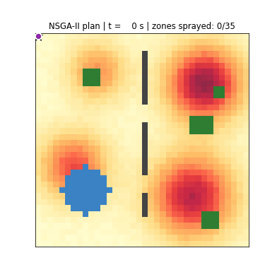
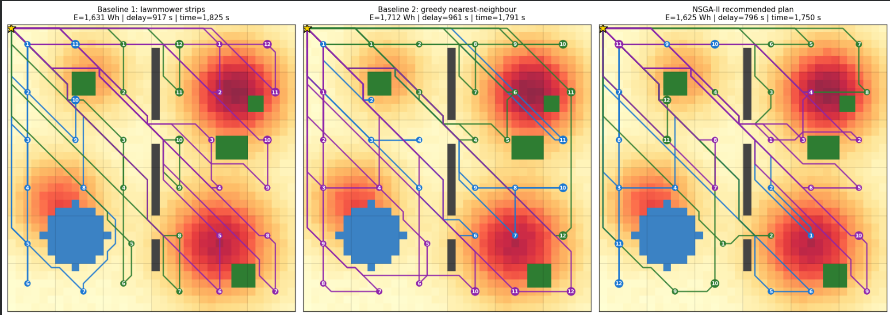
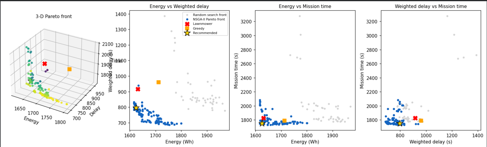
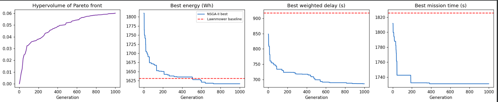
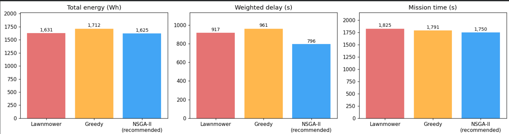
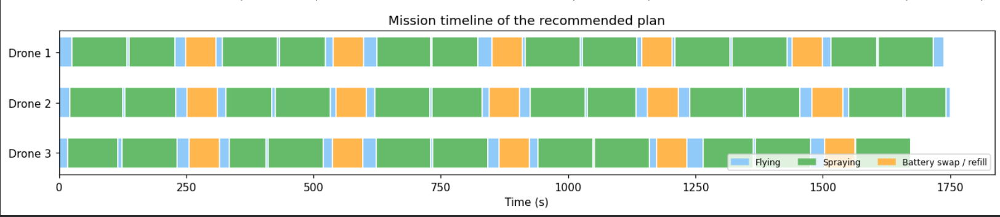

# Multi-Drone Precision Spraying Route Planning using NSGA-II



> Agriculture | Evolutionary multi-objective optimisation | Python, pymoo, Google Colab

**Team:** Niveditha S(RA2411047010028), Krishna Priya K U(RA2411047010045)|

**Course:** Evolutionary Computing |  

**Institution:** SRM Institute of Science and Technology

[](https://colab.research.google.com/github/<your-username>/<your-repo>/blob/main/drone_spraying_nsga2.ipynb)

---

## 1. Problem statement

Farms increasingly use drones to spray pesticide and fertiliser. A fleet of **3 drones** must cover a **180 m x 180 m field** that contains no-fly obstacles (a pond, tree clusters and a power line with only two gaps). Each drone has a limited **battery** and **tank**, so it must return to the depot to swap and refill. **Wind** makes flying east cheaper and flying west more expensive. Parts of the field are **disease hotspots** that should be treated first.

The field is split into 35 sprayable zones. We must decide **which drone sprays which zone, and in what order**, so that three conflicting objectives are minimised:

| Objective | Meaning |
|---|---|
| f1 Total energy (Wh) | wind-aware flight + spraying + extra trips to the depot |
| f2 Priority-weighted delay (s) | average spraying time of each zone, weighted by disease severity (hotspots first) |
| f3 Mission time (s) | when the last drone lands (workload balance) |

## 2. Related work (short review)

* **Coverage path planning** for robots and UAVs is surveyed by Galceran and Carreras (2013). Classic strip (lawnmower) sweeps are the standard farm practice and our first baseline.
* **Vehicle routing / multiple travelling salesmen:** assigning locations to several vehicles and ordering them is the multi-TSP / vehicle routing family (Dantzig and Ramser, 1959), which is NP-hard, so metaheuristics are widely used.
* **Multi-objective evolutionary algorithms:** NSGA-II (Deb et al., 2002) uses non-dominated sorting and crowding distance and is a widely used method for problems with conflicting objectives (Coello Coello et al., 2007).
* A. García-Munguía, P. L. Guerra-Ávila, E. Islas-Ojeda, J. L. Flores-Sánchez, O. Vázquez-Martínez, A. M. García-Munguía, and O. García-Munguía, “A review of drone technology and operation processes in agricultural crop spraying,” Drones, vol. 8, no. 11, Art. no. 674, 2024, doi: 10.3390/drones8110674.
* A. Hafeez, M. A. Husain, S. P. Singh, A. Chauhan, M. T. Khan, N. Kumar, A. Chauhan, and S. K. Soni, “Implementation of drone technology for farm monitoring & pesticide spraying: A review,” Information Processing in Agriculture, vol. 10, no. 2, pp. 192–203, 2023, doi: 10.1016/j.inpa.2022.02.002.

## 3. Methodology

**Algorithm: NSGA-II** (pymoo implementation). Justification: three conflicting objectives, combinatorial decision space, and the farmer benefits from choosing a trade-off from a Pareto front.

| Component | Choice |
|---|---|
| Encoding | permutation of zones plus (drones - 1) separators (multi-TSP chromosome) |
| Crossover | Order Crossover (OX), probability 0.9 |
| Mutation | Inversion mutation |
| Population / generations | 200 / 1000 (200,000 evaluations) |
| Fitness | mission simulator: wind-aware Dijkstra paths around obstacles, battery and tank limits, depot returns |
| Selection | non-dominated sorting + crowding distance |
| Seed | 42 (reproducible) |

**Workflow:** build field and hotspot map, compute wind-aware obstacle-avoiding paths between all zones, simulate a mission for any chromosome, run NSGA-II, select a knee solution, compare with baselines, run robustness tests.

**Baselines:** (1) lawnmower strips: one vertical strip per drone swept in a serpentine order; (2) greedy nearest-neighbour: the earliest-free drone flies to its nearest unsprayed zone; (3) random search with the same 200,000-evaluation budget.

## 4. Repository structure

```
.
├── drone_spraying_nsga2.ipynb   # full code + outputs (runs in Google Colab)
├── requirements.txt
├── README.md
└── results/
    ├── 01_field.png ... 06_timeline.png
    ├── spraying_mission.gif
    ├── pareto_front.csv
    ├── comparison_table.csv
    └── summary.json
```

## 5. Installation and how to run

**Google Colab (recommended):** click the Colab badge above, then `Runtime -> Run all` (about 3-6 minutes, CPU only).

**Locally:**
```bash
git clone https://github.com/Niveditha-28/drone_spraying_nsga2.git
cd drone_spraying_nsga2
pip install -r requirements.txt
jupyter notebook drone_spraying_nsga2.ipynb
```

## 6. Results

Single run with seed 42 (the plan recommended is the knee solution among Pareto plans that dominate the lawnmower baseline).

| Strategy | Energy (Wh) | Weighted delay (s) | Mission time (s) |
|---|---|---|---|
| Lawnmower strips (baseline) | 1630.8 | 916.9 | 1825.4 |
| Greedy nearest-neighbour (baseline) | 1712.5 | 960.9 | 1791.0 |
| NSGA-II: min energy | 1616.7 | 831.5 | 1746.8 |
| NSGA-II: min weighted delay | 1753.6 | 686.2 | 1775.2 |
| NSGA-II: min mission time | 1658.6 | 789.7 | 1731.1 |
| **NSGA-II: recommended (knee)** | **1624.6** | **795.6** | **1750.3** |

**Recommended plan vs baselines (negative = better):**

| | Energy | Weighted delay | Mission time |
|---|---|---|---|
| vs Lawnmower | -0.4 % | **-13.2 %** | -4.1 % |
| vs Greedy | -5.1 % | **-17.2 %** | -2.3 % |

The most hotspot-focused plan on the front reaches a weighted delay of 686 s, which is **25 % lower** than the lawnmower, at the cost of about 7.5 % more energy.

### Screenshots







## 7. Performance analysis

* **Pareto front:** 111 non-dominated plans; **8 dominate the lawnmower** and **56 dominate the greedy** baseline (better or equal in all objectives, strictly better in at least one).
* **NSGA-II vs random search (same 200,000 evaluations):** hypervolume **0.0601 vs 0.0056** (about 11 times larger). Best delay found: 686 s vs 778 s.
* **Robustness (5 seeds, population 100, 500 generations):** hypervolume 0.047 +/- 0.001; best energy 1630.6 +/- 10.3 Wh; best delay 710.3 +/- 7.6 s; best mission time 1740.0 +/- 4.2 s. Results are stable across seeds.
* **Runtime:** about 30 seconds for the main NSGA-II run on a standard CPU.
* **Honest reading:** the large gain is in **hotspot-first delay**. Energy improves only slightly, because spraying energy is fixed by the area and strip sweeping is already an efficient energy heuristic. The Pareto front shows the real trade-off between energy and delay.

## 8. Limitations and future work

* Zone-level planning (not row-by-row), constant wind, synthetic disease map, simplified (illustrative) energy model, no drone-to-drone collision avoidance.
* Future: memetic variant with route local search, real NDVI/multispectral maps, time-varying wind, many-objective version with chemical-dose limits.

## 9. References

1. K. Deb, A. Pratap, S. Agarwal, T. Meyarivan, "A fast and elitist multiobjective genetic algorithm: NSGA-II," *IEEE Trans. Evolutionary Computation*, 6(2), 182-197, 2002.
2. J. Blank and K. Deb, "pymoo: Multi-objective Optimization in Python," *IEEE Access*, 8, 89497-89509, 2020.
3. E. Zitzler and L. Thiele, "Multiobjective evolutionary algorithms: a comparative case study and the strength Pareto approach," *IEEE Trans. Evolutionary Computation*, 3(4), 257-271, 1999.
4. E. Galceran and M. Carreras, "A survey on coverage path planning for robotics," *Robotics and Autonomous Systems*, 61(12), 1258-1276, 2013.
5. G. B. Dantzig and J. H. Ramser, "The truck dispatching problem," *Management Science*, 6(1), 80-91, 1959.
6. C. A. Coello Coello, G. B. Lamont, D. A. Van Veldhuizen, *Evolutionary Algorithms for Solving Multi-Objective Problems*, 2nd ed., Springer, 2007.
